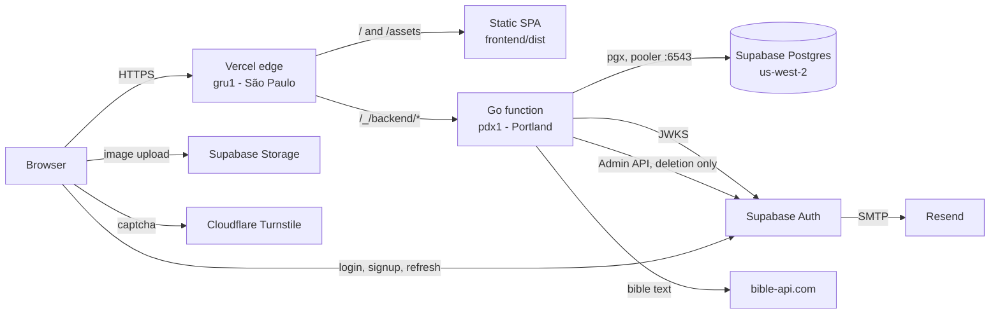
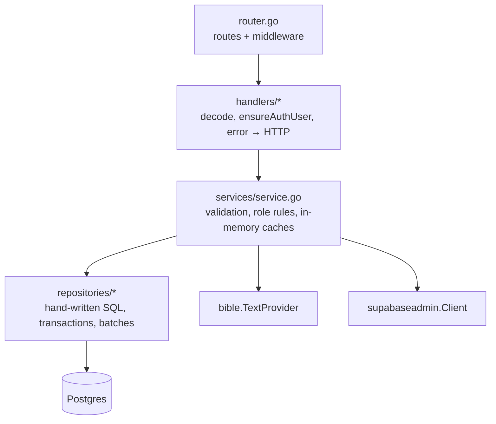
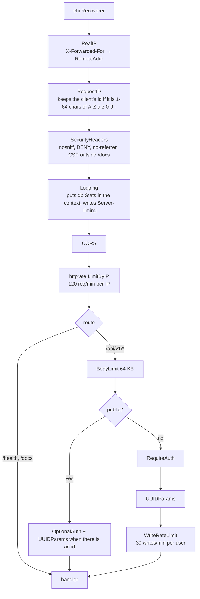
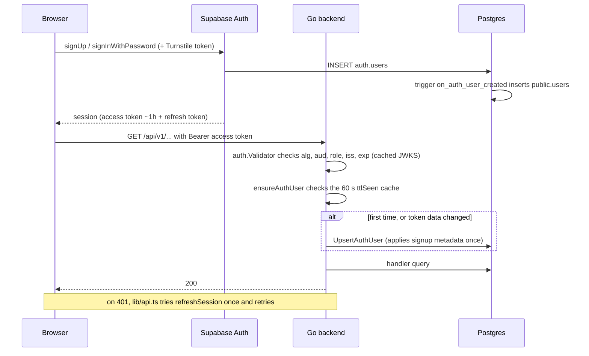
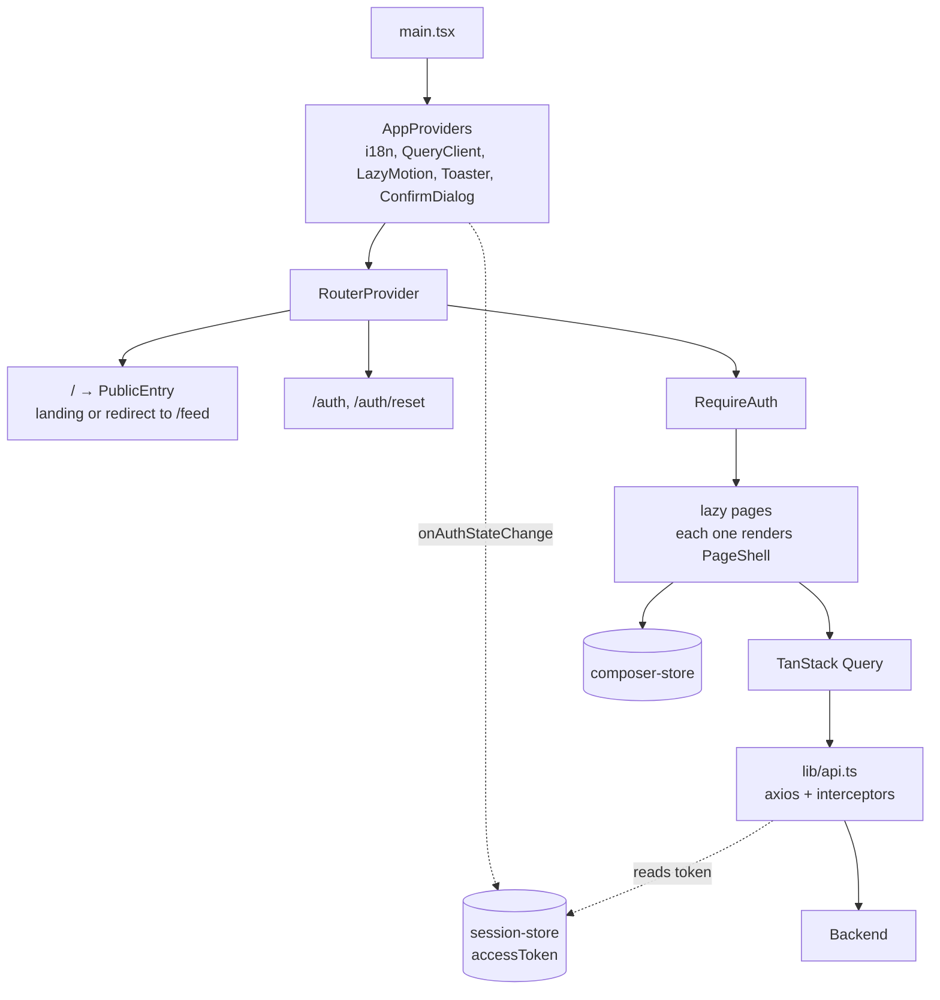

# 2. Architecture

## Deployment view

A single Vercel project serves two "services" (`experimentalServices` in the
root `vercel.json`): the static SPA at `/` and the Go API at `/_/backend`. Both
come from the same domain, so there is no CORS in production. All state lives
in Supabase.



Things that are not obvious:

- **The function runs in `pdx1`, far from users and close to the database.**
  The backend makes several database trips per request. With the function in
  São Paulo and the database in Oregon, each trip cost ~150 ms. Next to the
  database a trip costs a few ms, and the user pays the long distance once
  (browser → function). See [08-decisions.md](08-decisions.md#d05-function-in-pdx1-set-in-the-dashboard).
- **The region is set in the Vercel dashboard** (Settings → Functions →
  Function Region). The `regions` key in `backend/vercel.json` is ignored by
  `experimentalServices`. To check in production, the `x-vercel-id` response
  header should look like `gru1::pdx1::...` (edge::function).
- **`framework: "go"` must stay on the `backend` service.** The folder has a
  `go.mod` and a legacy `Dockerfile`; without the pin, the Vercel CLI detects
  both and refuses to build.
- **The frontend talks to Supabase directly** for authentication (login,
  signup, refresh, password reset) and for image uploads to Storage. The
  backend never sees a password.
- **A serverless function freezes after it responds.** There is no background
  work: everything that must happen (notification, milestone) happens before
  the response. This shapes how writes are designed (see
  [04-backend.md](04-backend.md#side-effects-without-background-work)).

In development the topology is the same minus Vercel: Vite on `:5173`, Go on
`:8080`, and the same Supabase project (no local Postgres is set up). CORS does
apply there, configured by `CORS_ALLOWED_ORIGINS`.

## Backend layers



| Layer | Does | Does not |
|---|---|---|
| **Handler** | Decodes JSON and query strings, calls `ensureAuthUser`, calls **one** service method, turns the error into status + `code` with `errors.Is` | Touch the pool, validate business rules |
| **Service** | Normalizes and validates input (lengths, enums), applies role rules (`RemoveGroupMember`, `ChangeMemberRole`), orchestrates merged feeds, keeps process-level caches (`cachedCount`, `ttlSeen`) | SQL |
| **Repository** | Runs SQL, transactions and batches; applies visibility predicates; inserts notifications | Pick HTTP error messages |

Firm rule: never skip a layer. A handler that needs data calls the service,
even if the service method only passes the call through.

The `repositories.Repository` interface sits at the top of `repository.go`.
There is a single implementation (`PostgresRepository`); the interface exists
so the service does not depend on pgx.

### Why the files are monolithic

`repository.go` (~4000 lines), `service.go` (~1700) and `models.go` (~660) hold
almost everything. That is deliberate: with a small team, finding any SQL with
one `grep` in one file was worth more than a folder structure. The only splits
are `account.go` (LGPD) and the handlers, one per resource. See
[08-decisions.md](08-decisions.md#d02-monolithic-repository-and-service-files).

## Path of a request

Actual middleware order (`router.go`):



Inside the handler:

1. `ensureAuthUser(h.service, r)` syncs the token's user into the `users`
   table (details below). Failure becomes `401 ACCOUNT_DELETED` or
   `500 USER_SYNC_FAILED` through `writeAuthSyncError`.
2. The handler calls the service, which validates and calls the repository.
3. The repository runs SQL. Every database trip goes through `db.Tracer`,
   which adds to the `db.Stats` in the context.
4. The response carries `Server-Timing: app;dur=…, db;dur=…;desc="N rt"` (plus
   `cold` on the first request of an instance), and the `http_request` log line
   records `dbRoundTrips`, `dbStatements`, `dbDuration` and `coldStart`.

Errors always use the `shared.WriteError` envelope:

```json
{ "error": { "code": "GROUP_NOT_FOUND", "message": "...", "details": {} } }
```

### Public routes

Only four `/api/v1` routes accept anonymous visitors: `GET /feed`,
`GET /feed/public` (same handler), `GET /username-availability` and
`GET /verses/shares/{id}`. With a valid token they take the reader into account
(tradition, blocks). The anonymous public feed responds with
`Cache-Control: public, s-maxage=30` and `Vary: Authorization`, so the CDN
absorbs visitor traffic.

## Authentication

Supabase Auth is the identity provider. The backend only validates the JWT and
keeps a copy of the profile in the `users` table.



Details:

- **Validation** (`internal/auth/jwks.go`): `ES256`/`RS256` only; `aud` and
  `role` must equal `authenticated` (`anon` and `service_role` tokens, signed
  by the same key, are rejected); `exp` required; 30 s leeway; `iss` must
  match `JWT_ISSUER`. The JWKS is cached for `JWKS_CACHE_TTL` (10 min); an
  unknown `kid` forces a refresh, at most once every 30 s. A token with no
  `kid` is only accepted when the JWKS has exactly one key.
- **Claims used**: `sub` (id), `email`, and from `user_metadata`: `username`,
  `display_name` and `tradition`. They go into the request context
  (`middleware.ContextKey*`).
- **Two things create the `users` row**: the `handle_new_auth_user` trigger
  (on `INSERT` into `auth.users`, with a username derived from the email) and
  the backend's `UpsertAuthUser`. The trigger always runs first, so the upsert
  always hits `ON CONFLICT`. That is why `users.signup_metadata_applied` exists
  (migration 000018): on the first request, the backend applies the tradition
  and `@username` chosen at signup and sets the flag, so it never overwrites
  later changes.
- **Sync cache**: `EnsureAuthUser` remembers the key
  `id|email|username|name|tradition` for 60 s. If any token field changes, the
  key changes and the upsert runs right away. Without this cache, every
  authenticated request paid one extra database trip.
- **Deleted account**: the access token stays valid for up to 1 h after
  `DELETE /me`. The upsert's `UPDATE` has `WHERE users.deleted_at IS NULL`;
  when no row comes back, the repository returns `ErrAccountDeleted` and the
  handler responds `401 ACCOUNT_DELETED`. The frontend then calls
  `signOut({ scope: 'local' })`.

## Frontend architecture



- **Routes** (`app/router.tsx`): `createBrowserRouter`. The landing page,
  `/auth` and `/auth/reset` are in the initial bundle; everything else is
  `lazy`. `lazyPage` reloads the page once when a chunk disappears after a
  deploy (the SPA rewrite would otherwise serve `index.html` in place of the
  module).
- **Guards** (`app/route-guards.tsx`): `RequireAuth` only checks for an
  `accessToken` in the store and redirects to `/auth?next=...`. `PublicEntry`
  sends signed-in users to `/feed`.
- **Session**: Zustand keeps the access token in `localStorage`;
  `AppProviders` keeps it in sync with `supabase.auth.onAuthStateChange`. The
  axios interceptor always prefers Supabase's current token (`getSession()`),
  tries `refreshSession()` once on a 401, and calls
  `signOut({ scope: 'local' })` if the refresh fails.
- **Server data**: all through TanStack Query (`staleTime` 30 s, `retry` 1).
  Zustand is only for global UI state (session and the two composers). Details
  in [05-frontend.md](05-frontend.md).
- **API base URL**: `VITE_API_BASE_URL`; without it, `localhost` uses
  `http://<host>:8080/api/v1` and any other host uses `/_/backend/api/v1`.
- **Build**: Vite with `manualChunks` splitting `supabase`, `i18n`, `query`,
  `motion` and `vendor`, so each one caches on its own.

## Observability

There is no APM and no error tracking. What exists:

| Signal | Where |
|---|---|
| Structured log (zap, JSON) per request | `middleware/logging.go`: method, path, status, duration, `requestId`, `dbRoundTrips`, `dbStatements`, `dbDuration`, `coldStart` |
| `Server-Timing` | Same middleware. Shows up in the DevTools Timing tab |
| `X-Request-Id` | Returned on every response and written to the log |
| Side-effect logs | `log.Printf` when a notification or bible text lookup fails (best-effort) |
| Page analytics | Vercel Web Analytics, cookieless, with anonymized URLs (`lib/analytics.ts`) |

On Vercel, logs are in the project dashboard (Logs tab of the backend service).
