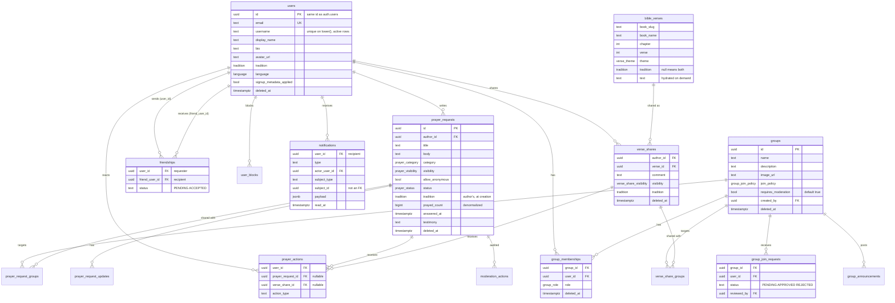

# 3. Database

Postgres managed by Supabase (project in `us-west-2`). The backend connects
through the **transaction pooler** (port `6543`) as the `postgres` role, which
owns the tables and has `BYPASSRLS`. Migrations run with `golang-migrate`
against the **direct** connection (port `5432`). The current version is `21`.

Schema facts in this document were checked against both the migration files
and the live database (`information_schema`, `pg_indexes`) in October 2026.

## Entity-relationship diagram

Main columns only. Every table has `id uuid` (`gen_random_uuid()`) and
`created_at`, except the join tables, which use composite keys.

Not in the diagram: `prayer_request_updates`, `group_announcements`,
`user_blocks`, `moderation_actions`, and the unused `moderation_queue` and
`bans` (see [Legacy and divergences](#legacy-and-divergences)).

## Tables

### Identity and social graph

**`users`** — local copy of the Supabase user. `id` is the same UUID as
`auth.users.id` (no FK across schemas). Created by the `handle_new_auth_user`
trigger at signup and updated by the backend's `UpsertAuthUser` (see
[02-architecture.md](02-architecture.md#authentication)). `username` is unique
case-insensitively among active rows (`idx_users_username_unique` on
`lower(username) WHERE deleted_at IS NULL`). `tradition` and `language`
default to `CATHOLIC` and `PT_BR`. Deleting an account does not delete the row:
it anonymizes it (see [07-security-privacy.md](07-security-privacy.md)).
`email_notifications_enabled` and `in_app_notifications_enabled` are only read
by the data export; no feature uses them yet.

**`friendships`** — one row per relationship, directed: `user_id` sent the
request, `friend_user_id` received it. `status` is `PENDING` or `ACCEPTED`
(the `BLOCKED` value allowed by the CHECK is legacy; blocks live in
`user_blocks`). `UNIQUE (user_id, friend_user_id)` plus
`CHECK (user_id <> friend_user_id)`. Queries always look in both directions.
Rejecting, cancelling and unfriending **delete** the row, which is why a
friend-request notification can report `friendRequestStatus = GONE`.

**`user_blocks`** — `blocker_user_id` → `blocked_user_id`, unique per pair, no
self-block. The only tables with `ON DELETE CASCADE` towards `users` are this
one and `moderation_actions`, but since users are never hard-deleted this does
not matter in practice. Every visibility predicate checks blocks **in both
directions**.

### Groups

**`groups`** — `join_policy` decides how people join. `requires_moderation`
defaults to `true` and the API has no way to change it, so **in practice every
group moderates** `GROUP_ONLY` requests (see
[06-domains.md](06-domains.md#moderation)). Soft-deleted.

**`group_memberships`** — `(group_id, user_id)` unique, with `role`. Leaving or
being removed sets `deleted_at`; joining again revives the row with
`ON CONFLICT ... DO UPDATE SET deleted_at = NULL`.

**`group_join_requests`** — for `REQUEST` groups. `(group_id, user_id)` unique;
asking again resets the existing row to `PENDING`.

**`group_announcements`** — admin/moderator posts with `event_at` (required)
and an optional `image_url`. Soft-deleted.

### Content

**`prayer_requests`** — the core table.
- `tradition` is a **snapshot** of the author's tradition at creation time.
  Feeds filter by it, so changing tradition does not move old posts.
- `status`: `ACTIVE` (visible), `PENDING_REVIEW` (waiting for a group
  moderator), `ARCHIVED` (changes requested, or deleted by the author),
  `REMOVED` (rejected/removed by moderation). `CLOSED` exists in the enum but
  nothing writes it.
- `prayed_count` is a denormalized total, bumped in the same statement as the
  reaction insert (`reactionSQL`). Per-type counts are computed on read.
- `answered_at` / `testimony` (migration 000015) mark "graça alcançada".

**`prayer_request_groups`** — which groups a request is shared with. The PK is
`(prayer_request_id, group_id)`.

**`prayer_request_updates`** — author updates. Hard-deleted only on account
deletion.

**`prayer_actions`** — reactions. **Polymorphic** since migration 000020:
exactly one of `prayer_request_id` / `verse_share_id` is set, enforced by
`CHECK prayer_actions_one_subject`. Old queries did not need to change because
they all filter `prayer_request_id = ...`, and `NULL` never matches. Having one
table keeps "total prayers" (`ProfileStats.PrayerActionsTotal`) in one place.
`action_type` is `text`, not an enum: the valid values per tradition live in Go
(`prayerActionRules` in `service.go`) and are checked inside the reaction
statement.

**`bible_verses`** — curated catalog: reference + theme + optional tradition.
`text` starts `NULL` and is filled on first read from bible-api.com, then
persisted (`SetVerseText`). The 12 deuterocanonical verses are seeded with text,
because the free Portuguese translations only cover the Protestant canon.
`tradition IS NULL` means the verse serves both traditions.

**`verse_shares`** / **`verse_share_groups`** — a shared verse of the day with a
comment. Has its own visibility enum that adds `FRIENDS`. No denormalized
counter: the count is summed from `prayer_actions` on read.

### Notifications and moderation

**`notifications`** — in-app notifications. `subject_type` + `subject_id` tell
the frontend where to navigate; `subject_id` is **not** a foreign key because
it may point to different tables (`PRAYER_REQUEST`, `FRIENDSHIP`, `GROUP`,
`MILESTONE`, `VERSE_SHARE`). `payload` holds extra display data (reaction type,
group name, milestone count...). Unread rows are covered by the partial index
`idx_notifications_user_unread`.

**`moderation_actions`** — audit log of moderation decisions on requests:
`prayer_request_id`, `group_id`, `actor_user_id`, `action`
(`APPROVE`/`REJECT`/`REQUEST_CHANGES`/`REMOVE`/`BAN` as a CHECK on text),
`reason`. ⚠️ See [Legacy and divergences](#legacy-and-divergences): a fresh
database gets a different shape for this table.

## Enums

| Postgres type | Values | Mirrored in |
|---|---|---|
| `prayer_category` | `HEALTH`, `FAMILY`, `WORK`, `GRIEF`, `THANKSGIVING`, `OTHER` | `models.PrayerCategory`, `frontend/src/lib/categories.ts` |
| `prayer_visibility` | `PUBLIC`, `GROUP_ONLY`, `PRIVATE` | `models.Visibility` |
| `prayer_status` | `PENDING_REVIEW`, `ACTIVE`, `CLOSED`, `ARCHIVED`, `REMOVED` | `models.PrayerStatus` |
| `verse_share_visibility` | `PUBLIC`, `FRIENDS`, `GROUP_ONLY`, `PRIVATE` | `models.VerseShareVisibility` |
| `group_join_policy` | `OPEN`, `REQUEST`, `INVITE_ONLY` | `models.GroupJoinPolicy` |
| `group_role` | `MEMBER`, `MODERATOR`, `ADMIN` | `models.GroupRole`, `RoleRank`; `ROLE_RANK` in the frontend |
| `tradition` | `CATHOLIC`, `EVANGELICAL` | `models.Tradition`, `Tradition` in `frontend/src/lib/traditions.ts` |
| `language` | `PT_BR`, `EN`, `ES` | `models.Language`, `lib/i18n.ts` (`toBackendLanguage`) |
| `verse_theme` | `HOPE`, `GRIEF`, `GRATITUDE`, `FORGIVENESS`, `FAITH`, `FAMILY`, `HEALING`, `PROVISION`, `COURAGE`, `PEACE`, `GUIDANCE`, `LOVE` | `models.VerseTheme` |
| `moderation_action_type` | `APPROVE`, `REJECT`, `REQUEST_CHANGES`, `REMOVE`, `BAN` | Unused in production (see below) |

Text columns with a CHECK instead of an enum: `friendships.status`,
`group_join_requests.status`, `moderation_actions.action`. Plain text with no
check: `prayer_actions.action_type`, `notifications.type`,
`notifications.subject_type` (values are defined in `models.go`).

Adding a value to a Postgres enum (`ALTER TYPE ... ADD VALUE`) cannot run
inside the same transaction that uses it; keep that in its own migration.

## Indexes

Grouped by the access pattern they serve:

| Pattern | Indexes |
|---|---|
| Public feed by tradition | `idx_prayer_requests_tradition_public_feed (tradition, status, created_at DESC) WHERE visibility='PUBLIC' AND deleted_at IS NULL`; `idx_verse_shares_public_feed (tradition, created_at DESC) WHERE visibility='PUBLIC' AND deleted_at IS NULL` |
| Author's content | `idx_prayer_requests_author_id`, `idx_verse_shares_author` |
| Reaction counts in the enrich (`GROUP BY subject, action_type`) | `idx_prayer_actions_request_type (prayer_request_id, action_type)` (000016), `idx_prayer_actions_verse_share_type` |
| Reaction dedupe window per user | `idx_prayer_actions_user_request_created_at`, `idx_prayer_actions_user_verse_created_at` |
| Active memberships | `idx_group_memberships_user_id`, `idx_group_memberships_group_id_active`, `idx_group_memberships_role` (all `WHERE deleted_at IS NULL`) |
| Content shared with a group | `idx_prayer_request_groups_group_id`, `idx_verse_share_groups_group` |
| Friend graph in both directions | `idx_friendships_user_status`, `idx_friendships_friend_status` |
| Notification list and unread badge | `idx_notifications_user_created_at`, `idx_notifications_user_unread (user_id) WHERE read_at IS NULL` |
| Daily verse pool with a stable order | `idx_bible_verses_pool (tradition, id) WHERE deleted_at IS NULL` |

**At the current data volume the planner ignores most of these.** With a few
dozen rows, a sequential scan is cheaper than any index. The indexes are there
for when data grows; index tuning only makes sense after seeding a
representative dataset. Until then, optimize round trips (see
[04-backend.md](04-backend.md#round-trip-budget)).

There are a few redundant indexes: `idx_bans_group_user` duplicates the
`UNIQUE (group_id, user_id)` on `bans`, and `idx_groups_active` on `(id)`
mostly duplicates the PK. Harmless at this size.

## Functions and triggers

| Object | What it does |
|---|---|
| `public.handle_new_auth_user()` + trigger `on_auth_user_created` on `auth.users` | Creates the `public.users` row at signup. Username = lowercase local part of the email with non `[a-z0-9_]` removed, `user_<8 chars of id>` if that is empty, plus `_2`, `_3`... on collision (loop added in 000005; 000004 had no collision handling and could fail signup). `SECURITY DEFINER` because it runs as the Supabase Auth role. |
| `public.is_group_admin_or_moderator(gid uuid)` | Used by the Storage policy of the `group-photos` bucket (uploads go straight from the browser). `SECURITY DEFINER` with `SET search_path = public`: the policy runs as `authenticated`, which lost access to `group_memberships` when RLS was turned on. It was created in the dashboard and moved into migration 000021. |

The Storage buckets (`avatars`, `group-photos`) and their policies are **not**
in migrations; they are created by hand (`DEPLOY.md §1`, items 4 and 5).

## Conventions

- **Soft delete**: content tables use `deleted_at timestamptz`. Every list
  query filters `deleted_at IS NULL`, including on joined `users`
  (`u.deleted_at IS NULL`), so deleted accounts disappear from lists.
- **Tradition filter**: every feed query keeps `tradition = <reader's
  tradition>`. Forgetting it mixes Catholic and Evangelical feeds.
- **RLS on every table**: required for any new table in the same migration
  (`ALTER TABLE ... ENABLE ROW LEVEL SECURITY`). No policies are needed because
  the backend bypasses RLS; the point is to lock out PostgREST, which the public
  anon key can reach. See [07-security-privacy.md](07-security-privacy.md#row-level-security).
- **Idempotent DDL**: migrations use `IF NOT EXISTS` and `DO $$ ... $$` guards
  for enums. Note that this idempotency caused the `moderation_actions` problem
  below.
- **Notifications written in the same transaction** as the event that caused
  them, through a savepoint so a failed notification does not abort the main
  write (`insertNotificationInTx`).
- **Timestamps** are `timestamptz`. Day boundaries that matter to the product
  (daily verse, streaks) use `America/Sao_Paulo` explicitly.

## Migration history

| # | Name | What it does | Why |
|---|---|---|---|
| 000001 | `init` | Base schema: users, groups, memberships, prayer requests, groups link, updates, actions, moderation queue/actions, bans, notifications; enums | Initial scaffold (Feb 2026) |
| 000002 | `social` | `friendships`, `group_join_requests` | Friends and request-to-join groups |
| 000003 | `auth_profile_sync` | `handle_new_auth_user` trigger on `auth.users` | Every Supabase user gets a `public.users` row at signup |
| 000004 | `usernames` | `users.username`, backfill, unique index on `lower(username)`; trigger sets username | `@username` for the friends network |
| 000005 | `username_trigger_fix` | Trigger adds a numeric suffix on username collision | Two emails with the same local part broke signup |
| 000006 | `tradition` | `tradition` enum on users and requests (backfill `CATHOLIC`), tradition-aware feed indexes | Catholic and Evangelical feeds are separate |
| 000007 | `group_admin` | Partial indexes on active memberships and groups | Group admin screens (members, roles) |
| 000008 | `notifications` | `CREATE TABLE IF NOT EXISTS notifications` with `actor_user_id`, `subject_*` | In-app notifications. ⚠️ No-op on databases that ran 000001, where the table already existed; 000010 fixed that |
| 000009 | `user_bio` | `users.bio` | Profile bio |
| 000010 | `notifications_align` | Adds `actor_user_id`, `subject_type`, `subject_id` to `notifications` | Bring the 000001 table in line with what 000008 intended |
| 000011 | `user_blocks` | `user_blocks` | Block in both directions (feeds, friend requests) |
| 000012 | `moderation_actions` | `CREATE TABLE IF NOT EXISTS moderation_actions` with a new shape | Audit of approve/reject/request-changes. ⚠️ See below |
| 000013 | `group_announcements` | `group_announcements` | Group wall announcements |
| 000014 | `user_language` | `language` enum, `users.language` | UI language saved per user |
| 000015 | `prayer_answered` | `answered_at`, `testimony` on requests | "Graça alcançada" with testimony |
| 000016 | `prayer_actions_request_index` | `(prayer_request_id, action_type)` index | The enrich's reaction aggregation did a seq scan; the old index started with `user_id` |
| 000017 | `drop_duplicate_notifications_index` | Drops `idx_notifications_user_created` | It duplicated `idx_notifications_user_created_at` from 000001 |
| 000018 | `signup_metadata` | `users.signup_metadata_applied` (existing rows = `true`) | The trigger created the row first, so the tradition and username chosen at signup were lost. The flag lets the backend apply them exactly once |
| 000019 | `bible_verses` | `verse_theme` enum, `bible_verses`, 312-verse seed | Verse of the day: curation lives in the database because no public API answers "a verse about hope" |
| 000020 | `verse_shares` | `verse_share_visibility`, `verse_shares`, `verse_share_groups`; makes `prayer_actions` polymorphic | Share the daily verse to the feed and react to it with the same reactions |
| 000021 | `enable_rls` | RLS on every `public` table; revokes `anon`/`authenticated` grants, including default privileges; recreates `is_group_admin_or_moderator` as `SECURITY DEFINER` | The anon key ships in the bundle, and PostgREST let anyone read `users.email` |

## Legacy and divergences

⚠️ **`moderation_actions` has a different shape on a fresh database.**
Migration 000001 creates `moderation_actions` with columns `actor_user_id,
target_user_id, target_request_id, target_group_id, action
moderation_action_type, payload`. Migration 000012 uses
`CREATE TABLE IF NOT EXISTS` for a table with `prayer_request_id, group_id,
actor_user_id, action text, reason`. On a database that runs both in order,
000012 does nothing and the old table stays. `ApplyModerationAction` inserts
`(prayer_request_id, group_id, actor_user_id, action, reason)`, which would
fail there, so **moderation breaks on a fresh environment**. Production has the
000012 shape (and lacks the 000001 index `idx_moderation_actions_target_request_id`),
which means the old table was dropped by hand at some point. Recreating the
database from migrations needs a fix migration (drop and recreate, since the
table is empty) or an edit to 000001.

The same pattern hit `notifications` (000008 was a no-op), but 000010 adds the
missing columns, so the end result matches. The leftover `sent_email_at` and
the original `payload` column come from 000001.

Unused objects (no code reads or writes them):

| Object | Note |
|---|---|
| `moderation_queue` | The queue is computed from `prayer_requests.status = 'PENDING_REVIEW'` instead |
| `bans` | Banning is not implemented |
| `moderation_action_type` enum | Only used by the 000001 shape of `moderation_actions` |
| `prayer_status.CLOSED` | Never written |
| `friendships.status = 'BLOCKED'` | One search query still excludes it; blocks moved to `user_blocks` |
| `notifications.sent_email_at` | Email notifications are not implemented |

## Adding a migration

1. Next number = highest `NNNNNN_` in `backend/internal/db/migrations/` + 1.
   Write both `.up.sql` and `.down.sql`.
2. New table: `ENABLE ROW LEVEL SECURITY` in the same file, `deleted_at` if the
   content can be deleted by users, partial indexes `WHERE deleted_at IS NULL`.
3. Think about `IF NOT EXISTS`: it makes reruns safe, but it hides conflicts
   with an older definition (see above). Prefer failing loudly when changing an
   existing table's shape.
4. Personal data in the new table? Add it to `exportUserDataSQL` and to
   `DeleteAccount` in `repositories/account.go`.
5. New enum value? Mirror it in `models.go` and the frontend.
6. Run it (`09-development.md`), then `go build ./...`, and update the
   [migration history](#migration-history) above.
7. Commit the migration on its own (`feat(db): ...`).
