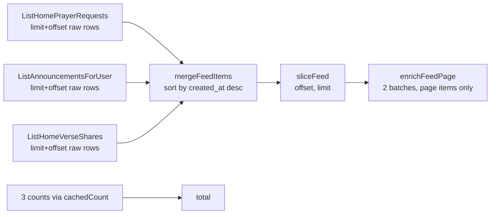

# 4. Backend

Go 1.22+, `chi` v5 for routing, `pgx` v5 with `pgxpool`, hand-written SQL, `zap`
for logs. No ORM, no code generation. Layering and the request path are in
[02-architecture.md](02-architecture.md); this document covers the patterns
inside each layer.

## Bootstrap (`cmd/api/main.go`)

1. `config.Load()` reads environment variables (defaults in
   `internal/config/config.go`). `DATABASE_URL`, `JWT_ISSUER` and `JWKS_URL`
   are required. `SupabaseURL` is derived from `JWT_ISSUER` (it drops the
   `/auth/v1` path).
2. `pgxpool` with explicit limits: `DB_MAX_CONNS` (8), `DB_MIN_CONNS` (0),
   connection lifetime 30 min, idle time 5 min. The tracer `db.Tracer{}` is
   attached here.
3. Manual dependency wiring: repository → bible provider → service (with the
   Supabase Admin client) → router.
4. `http.Server` with 15 s read/write timeouts, graceful shutdown on
   SIGINT/SIGTERM.
5. `_ "time/tzdata"` is imported so `America/Sao_Paulo` resolves even if the
   Vercel runtime has no system timezone database.

## Errors

Errors flow as Go sentinels and are translated to HTTP only in handlers.

- **Repository sentinels** (`repositories/repository.go`, top of the file):
  not-found and conflict facts, e.g. `ErrGroupNotFound`,
  `ErrPrayerRequestNotFound`, `ErrFriendRequestAlreadyExists`,
  `ErrUsernameTaken`, `ErrDuplicatePrayedAction`, `ErrAccountDeleted`.
- **Service sentinels** (`services/service.go`): validation and permission,
  e.g. `ErrInvalidTitle`, `ErrPermissionDenied`, `ErrLastAdmin`,
  `ErrCannotTargetSelf`, `ErrInvalidImageURL`.
- **Typed errors with data**: `*repositories.SoleAdminError` carries the groups
  that block an account deletion; the handler puts them in `details.groups`.
- **Handler mapping**: `errors.Is(err, X)` → `shared.WriteError(w, status,
  "CODE", message, details)`. Anything unmapped becomes
  `500 INTERNAL_ERROR`.

Common codes: `INVALID_JSON`, `INVALID_ID` (path id is not a UUID, rejected by
`middleware.UUIDParams` before reaching Postgres), `VALIDATION_ERROR`,
`FORBIDDEN`, `*_NOT_FOUND`, `LAST_ADMIN`, `RATE_LIMITED`, `UNAUTHORIZED`,
`ACCOUNT_DELETED`, `USER_SYNC_FAILED`, `INTERNAL_ERROR`.

**Invisible content answers 404, never 403**, so the API does not reveal that
something exists.

A new path parameter carrying an id must be added to `uuidParamNames` in
`middleware/uuid_params.go`, otherwise a malformed value reaches Postgres and
becomes a 500.

## Transactions

Multi-step writes use:

```go
tx, err := r.db.Begin(ctx)
if err != nil { return err }
defer tx.Rollback(ctx)
// ...
return tx.Commit(ctx)
```

Examples: `CreatePrayerRequest` (request + group links, membership checked per
group), `ApproveGroupJoinRequest` (request status + membership +
notification), `ApplyModerationAction`, `BlockUser` (block + delete
friendship), `DeleteAccount`.

## Notifications

Best-effort: a failed notification never fails the action that caused it.

- `insertNotificationOn(ctx, exec, in)` inserts one notification. `exec` is
  anything with `Exec` (pool or tx, the local `notifyExec` interface). Errors
  are logged and returned; callers do `_ = ...`.
- `insertNotificationInTx(ctx, tx, in)` wraps the insert in a **savepoint**.
  Inside a Postgres transaction a failed statement aborts the whole
  transaction, so without the savepoint a bad notification (FK violation, say)
  would roll back the main write.
- Fan-out should be one `INSERT ... SELECT`, never a loop. Announcements do it
  (`notifyGroupMembersOfAnnouncement`). ⚠️ `notifyPrayersOfRequest` (author
  updates and "answered") does not yet: it reads the distinct people who prayed
  through the pool (outside the caller's transaction) and inserts one
  notification per person, one trip each. Fine at today's numbers; it is the
  next candidate for the same treatment.
- Self-notification is skipped (actor == recipient).
- Reaction notifications are resolved in SQL (`reactionNotifySQL`): the
  `NOT EXISTS` applies a 60-minute dedupe window per (recipient, type, actor,
  subject).
- Any action that "resolves" what a notification is about must also mark it
  read. Accept/reject of a friend request does it in the same CTE
  (`markFriendRequestNotificationReadSQL`); otherwise the badge stays lit.
- The shell polls `GET /notifications/unread-count` every 30 s, so it is a
  single statement (`notificationSummarySQL`) returning `{ count,
  friendRequests }`.

## Round-trip budget

**This backend's bottleneck is the number of trips to the database, not query
duration.** Measured against Supabase, one round trip costs ~200 ms from a
machine in Brazil (a few ms from `pdx1`), and 50 statements in one message cost
the same as one. At the current data volume execution time is negligible; the
trip is what you pay for.

So: **count trips before optimizing anything.** Every request log has
`dbRoundTrips` and `dbStatements`, and the response has `Server-Timing`. The
tracer (`internal/db/trace.go`) counts a batch as **one** trip on purpose,
because that is the difference that matters.

Three tools, each with its place:

### 1. `pgx.Batch` when the queries are in the same repository method

Collapses N trips into 1 on a single connection. First choice. Results are read
in queue order with `nextBatchRows(br, scan)`.

Used in `EnrichPrayerRequests` (authors, answered state, groups, per-type
counts, viewer's own reactions), `EnrichVerseShares`, `GetUserStats`,
`ListModerationHistory`, `ListPrayerActionsByRequest`,
`ListPrayerRequestUpdates`, `ListVerseShareActions` (access check + list in the
same batch, list discarded if access is denied), the reaction side effects and
`DeleteAccount`.

### 2. Writable CTEs when a write depends on reads

`reactionSQL` builds one statement that, in order:

1. `viewer`: reads the user's tradition, resolves the default reaction type and
   the allowed list;
2. `target`: applies the canonical visibility predicate to the request or
   verse share;
3. `inserted`: inserts only if the type is allowed, the target is visible and
   there is no identical reaction within the window (`PRAYED_WINDOW_HOURS`,
   default 12);
4. optional `afterInsert`: bumps `prayer_requests.prayed_count`;
5. returns four booleans/values so Go can pick the right error
   (`ErrPrayerActionNotAllowed`, not found, `ErrDuplicatePrayedAction`)
   without another query.

### 3. `errgroup` when calls cross repository methods

Merged feeds call several repository methods (requests, announcements, verse
shares, and their counts). They run in parallel through `runBounded`,
**never** a raw `errgroup`. `maxParallelQueries = 3` because
`DB_MAX_CONNS = 8` for the whole process: an unbounded fan-out of six in one
request would take most of the pool and make latency worse under load. The
errgroup context cancels sibling tasks on the first error.

### Side effects without background work

Tempting: respond immediately and send notifications/milestones from a
goroutine. Not possible here: the Vercel function freezes after the response
and the work would die halfway. So the tail is **batched**, not deferred.
Reactions are two fixed trips:

1. the statement that decides and writes (`recordPrayerActionSQL` /
   `recordVerseShareActionSQL`);
2. one best-effort batch (`emitReactionSideEffects`) with the author
   notification plus the `MILESTONE_PRAYED` (`prayedMilestoneSQL`) and
   `MILESTONE_STREAK` (`streakMilestoneSQL`) checks, all resolved in SQL.

They cannot be merged: the side effect needs the reaction committed, and a
failure in it must not undo the reaction.

### Results of the optimization pass (September 2026)

Measured with ~200 ms per round trip:

| Path | Before | After |
|---|---|---|
| `ListFriendsFeed` | 4189 ms | 430 ms |
| `ListGroupsFeed` | 2920 ms | 415 ms |
| `ListHomeFeed` | 2502 ms | 421 ms |
| `ListPublicFeed` | 2256 ms | 411 ms |
| `ListGroupFeed` | 1839 ms | 617 ms |
| `GetUserStats` | 1164 ms | 207 ms |
| `RecordPrayerAction` | 5–7 trips | 2 trips |
| `RecordVerseShareAction` | 7–9 trips | 2 trips |

## Merged feeds

Home, groups, friends, public and the group wall mix three item types (prayer
requests, announcements, verse shares) into one list ordered by `created_at`.



Rules:

- Each stream fetches `limit + offset` **raw** rows (no enrich). The service
  merges, slices the page and only then enriches the final page with
  `enrichFeedPage`. Enriching inside `List*` doubled the cost of the feed for a
  while; do not reintroduce it.
- `mergeFeedItems(streams ...[]models.FeedItem)` is variadic. A new item type
  is one more stream, not one more positional parameter. Wrap rows with
  `models.WrapPrayerRequests`, `WrapAnnouncements`, `WrapVerseShares`.
- Feed `COUNT`s go through `Service.cachedCount` (in-process, 30 s TTL,
  `feedCountTTL`). The total only feeds the numbered pager, so being up to
  30 s stale is fine. New feed counts must use the same helper.
- Pagination is offset-based with a numbered pager. Fetching `limit + offset`
  per stream degrades with deep pages; keyset pagination was considered and
  deferred (see [08-decisions.md](08-decisions.md)).
- The group wall checks access first (`ensureGroupFeedAccess`, sequential on
  purpose so nothing is read before access is granted). `INVITE_ONLY` groups
  are visible only to members.
- **Preserve the tradition filter** and `deleted_at IS NULL` in every stream.

## Canonical visibility predicates

`prayerRequestVisibleTo(viewer)` and `verseShareVisibleTo(viewer)` in
`repository.go` return SQL fragments that are **the** rule for "this viewer can
see this item". Detail, reactions, "who prayed", updates and authorship checks
all concatenate the same fragment. Do not rewrite the rule in a new query.

For prayer requests:

```
deleted_at IS NULL AND (
  author = viewer                                  -- always sees own content
  OR (
    status = 'ACTIVE'
    AND tradition = viewer's tradition (or any, for anonymous visitors)
    AND (visibility = 'PUBLIC'
         OR (visibility = 'GROUP_ONLY' AND viewer is an active member of a target group))
    AND no block in either direction
  )
)
```

Verse shares follow the same shape, without the status check, with `FRIENDS`
(accepted friendship in either direction) as an extra visibility.

Feed stream queries do not use the fragment (they are written for their
specific audience) but must keep the same invariants: tradition,
`deleted_at IS NULL`, blocks in both directions, `PRIVATE` only for the author.

Code that only needs to decide permission uses `GetPrayerRequestAccess` (one
trip, returns author and anonymity) instead of `GetPrayerRequestByID` (two
trips, with enrich).

## Existence before permission

`GetGroupRoleOf` and `isGroupAdmin` start from `groups` and `LEFT JOIN` the
membership. A missing group becomes `ErrGroupNotFound` (404) in the same trip
that finds the role, so handlers under `/groups/{id}/...` must map
`ErrGroupNotFound`. Nested resources must belong to the parent in the URL:
`announcementInGroup` returns 404 if the announcement belongs to another group.

## In-process caches

| Cache | Where | TTL | Purpose |
|---|---|---|---|
| `feedCounts` (`cachedCount`) | `service.go` | 30 s | Feed totals and verse pool size |
| `syncedAuth` (`ttlSeen`) | `service.go` | 60 s | Skip the user upsert on every request |
| JWKS keys | `auth/jwks.go` | 10 min | Avoid fetching keys per request |
| `singleflight` | `bible/bible.go` | per call | Collapse concurrent fetches of the same verse |

All are per instance. On Vercel each instance has its own copy and starts cold.
Both service maps clean expired entries opportunistically once they pass 4096
keys.

## Verse of the day

- **Pool**: `bible_verses` rows where `tradition IS NULL OR tradition = <user's
  tradition>` and `deleted_at IS NULL`, ordered by `id`.
- **Deterministic pick**: `dailyVerseOffset(userID, day, poolSize)` =
  `fnv64a(userID + "|" + YYYY-MM-DD) % poolSize`, with the day in São Paulo
  time. There is no cron, so the choice must be recomputable on every request.
  **Changing the `ORDER BY id` in `GetVerseByPoolOffset` changes everyone's
  verse.**
- **Text on demand**: `hydrateVerseText` calls `bible.TextProvider.Fetch`
  (bible-api.com, `almeida` translation, public domain, 3 s timeout) and saves
  the text with `SetVerseText`. After that the API is out of the hot path.
- **Fallback**: the `almeida` translation has gaps (e.g. `ephesians 2:14`
  returns 404). `resolveVerseWithText` walks up to 4 neighbors in the pool,
  deterministically, until one has text; if none do, it returns the first
  candidate without text. Provider failures never propagate: the endpoint
  answers 200 and the frontend shows only the reference.
- ⚠️ The 300 references were **not** all validated against the API: the sweep
  hit the rate limit (15 requests / 30 s) and stopped. If you redo it, go
  serially with ~2 s between calls.

## API documentation (`/docs`)

Swagger UI at `http://localhost:8080/docs` (production:
`https://www.creo.com.br/_/backend/docs`). It reads
`internal/http/apidocs/openapi.yaml`, written by hand and embedded with
`go:embed`. A QA tester uses it.

- Changed a route, payload, validation or error code? Update `openapi.yaml` in
  the same commit. Nothing generates it, so it rots silently.
- Document only error codes the handler **actually** emits. When the behavior
  is odd (a 500 where a 404 would fit), document it with ⚠️ instead of the
  ideal.
- `servers` uses the relative URL `../api/v1`, resolved against the spec's own
  URL, which works in both environments with and without `/_/backend`.
- Lint: `npx @redocly/cli lint backend/internal/http/apidocs/openapi.yaml`
  (warnings about `operationId` and tag descriptions are expected).

## Adding an endpoint (checklist)

1. Model/input structs in `models.go`.
2. Repository method (SQL, transaction or batch; reuse the visibility
   predicates).
3. Service method (validation, permission, sentinel errors).
4. Handler: `ensureAuthUser` at the top if authenticated, map every sentinel
   the service can return.
5. Route in `router.go` (inside the `protected` group unless it is public).
   New id path param → `uuidParamNames`.
6. `openapi.yaml`.
7. Count the round trips in the log before calling it done.
8. `go build ./...`.
