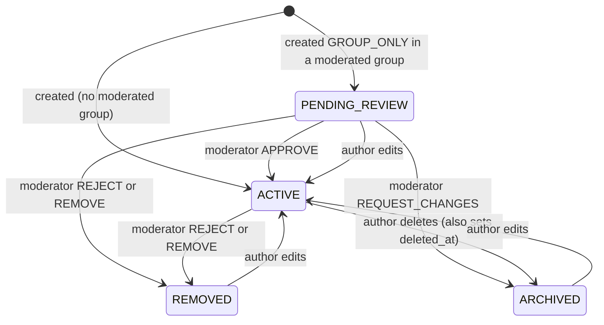
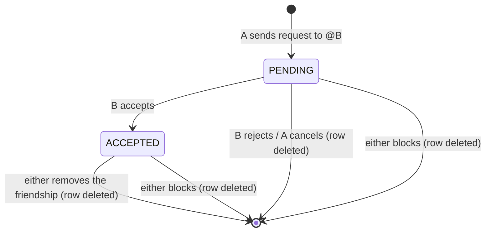

# 6. Domains

Business rules per area, as implemented. Where a rule lives in code is given
so you can check it.

## Prayer requests

### Creating

`POST /requests` → `Service.CreatePrayerRequest` → `Repository.CreatePrayerRequest`.

| Rule | Where |
|---|---|
| Title 3–120 chars, body 10–4000 (after trim, byte length) | service |
| Category in `prayer_category` | service |
| `GROUP_ONLY` needs ≥ 1 `groupIds`; `PRIVATE` accepts none; `PUBLIC` may carry groups | service |
| The author must be an active member of every target group, else `ErrGroupAccessDenied` | repository, per group, inside the transaction |
| `tradition` = the author's current tradition | `INSERT ... (SELECT tradition FROM users ...)` |
| Initial status: `PENDING_REVIEW` if `GROUP_ONLY` and any target group has `requires_moderation`, else `ACTIVE` | repository |
| After commit: `MILESTONE_CREATED` when the author's total hits 1, 10, 50 or 100 | `maybeEmitCreatedMilestone` |

Since `groups.requires_moderation` defaults to `true` and the API cannot change
it, **every `GROUP_ONLY` request starts in `PENDING_REVIEW`**.

### Visibility

| Visibility | Who sees it (besides the author) |
|---|---|
| `PUBLIC` | Everyone of the same tradition, including anonymous visitors on the public feed |
| `GROUP_ONLY` | Active members of at least one target group, same tradition |
| `PRIVATE` | Nobody |

On top of that: only `ACTIVE` requests, never soft-deleted ones, and never
across a block in either direction. The author always sees their own content in
any status. The full rule is `prayerRequestVisibleTo` (see
[04-backend.md](04-backend.md#canonical-visibility-predicates)).

**Anonymous** (`allow_anonymous`) is separate from visibility. For anyone but
the author, the enrich replaces the author with "Anônimo" (no username, no
avatar), author updates get the same treatment, and the friends page never
shows an anonymous request as a friend's "latest intention", because that would
reveal who wrote it. ⚠️ The response still includes `authorId`; see
[07-security-privacy.md](07-security-privacy.md#known-gaps).

### Feeds

| Feed | Endpoint | Prayer requests included |
|---|---|---|
| Home | `GET /feed/home` | Own requests (`ACTIVE` or `PENDING_REVIEW`) + friends' `PUBLIC` requests + requests in the reader's groups; plus announcements from the reader's groups and visible verse shares |
| Groups | `GET /feed/groups` | Requests, announcements and verse shares from every group the reader belongs to |
| Friends | `GET /feed/friends` | Friends' `PUBLIC` requests (and friends' verse shares) |
| Public | `GET /feed`, `/feed/public` | All `PUBLIC` + `ACTIVE` requests and public verse shares of the reader's tradition. Works without login |
| Group wall | `GET /groups/{id}/feed` | Requests, announcements and verse shares of that group. `INVITE_ONLY` → members only |

All feeds: same tradition only, blocks excluded, newest first, page size 20 by
default (max 100), numbered pagination with an approximate total.

The friends stream does not check `user_blocks` itself. It relies on an
invariant: blocking someone deletes the friendship (`BlockUser`), and
`SendFriendRequest` refuses when a block exists.

### Status lifecycle

⚠️ **Editing always sets `status = 'ACTIVE'`** (`UpdatePrayerRequest`), with no
moderation check. That is the intended way out of `ARCHIVED` after "request
changes", but it also lets an author re-publish a request that moderation
rejected (`REMOVED`) or skip the review queue by editing a `PENDING_REVIEW`
request. If moderation matters, edits should recompute the status the same way
creation does.

Editing replaces the whole request (title, body, category, visibility,
anonymity) and rewrites the group links.

### Reactions

`POST /requests/{id}/pray` with an optional `actionType`.

- Valid types depend on the reactor's **current** tradition (not the
  request's). Empty type = the tradition's default (`HAIL_MARY` for Catholics,
  `I_PRAYED` for Evangelicals). The lists live in `prayerActionRules`
  (`service.go`) and mirror `lib/traditions.ts`.
- Same user, same request, same type: once per `PRAYED_WINDOW_HOURS` (default
  12). A repeat returns `ErrDuplicatePrayedAction`. Different types count
  separately.
- Bumps `prayer_requests.prayed_count`.
- Side effects (best-effort, second trip): `PRAYED` to the author (skipped for
  self, deduped for 60 min per reactor), `MILESTONE_PRAYED` when the reactor's
  total reactions hit 10/50/100/500/1000, `MILESTONE_STREAK` on the reactor's
  first reaction of the day (São Paulo time) when the consecutive-day streak
  hits 7/30/100/365.

### Updates and "answered"

- `POST /requests/{id}/updates`: author only, 1–2000 chars. Notifies everyone
  who reacted (`REQUEST_UPDATED`).
- `POST /requests/{id}/answer` with an optional testimony (≤ 2000): sets
  `answered_at` (kept on later calls) and `testimony`; notifies everyone who
  reacted (`REQUEST_ANSWERED`). `DELETE /requests/{id}/answer` clears both.
  Answering does not change `status`.

## Moderation

Moderation applies to requests linked to groups.

- **Queue** (`GET /moderation/queue`): `PENDING_REVIEW` requests in groups
  where the reader is `ADMIN` or `MODERATOR`, oldest first.
- **Actions** (`POST /moderation/{requestId}/{approve|reject|request-changes}`):

  | Action | Allowed from | New status | Notification to author |
  |---|---|---|---|
  | `APPROVE` | `PENDING_REVIEW` | `ACTIVE` | `REQUEST_APPROVED` |
  | `REQUEST_CHANGES` | `PENDING_REVIEW` | `ARCHIVED` | `REQUEST_CHANGES_ASKED` |
  | `REJECT` | any | `REMOVED` | `REQUEST_REJECTED` |
  | `REMOVE` (service only, no route) | any | `REMOVED` | `REQUEST_REJECTED` |

  The status change, the `moderation_actions` audit row and the notification
  happen in one transaction. `REJECT` and `REQUEST_CHANGES` require a reason
  (`ErrModerationReasonRequired`); it goes to the audit row and to the
  author's notification payload.
- ⚠️ When a request targets several groups, the repository picks **one** of
  them (`LIMIT 1`, no order) as "the" group: only that group's moderators can
  act, and that is the group recorded in the audit row.
- **History** (`GET /moderation/{requestId}/history`): only the author and
  moderators/admins of a target group. The reason for a rejection is treated as
  internal group information.
- `BAN` exists in the enum and the CHECK but is not implemented.

## Groups

### Creating and joining

- Name 3–80, description ≤ 500, join policy required, image URL must be from
  this project's Storage. The creator becomes `ADMIN` in the same transaction.
- `POST /groups/{id}/join-requests`:
  - `OPEN` → becomes `MEMBER` immediately (reviving an old membership if any);
  - `REQUEST` → creates or resets a `PENDING` join request and notifies the
    group admins (`GROUP_JOIN_REQUESTED`);
  - `INVITE_ONLY` → `ErrInviteOnlyGroup`. There is no invite flow yet.
- Approve/reject join requests: admins only (`isGroupAdmin`, which also treats
  the group's `created_by` as admin). Approval creates the membership and
  notifies the user (`GROUP_JOIN_APPROVED`).

### Roles

| Action | Who |
|---|---|
| Edit group (name, description, policy, image) | `ADMIN` |
| Change a member's role | `ADMIN` |
| Remove a member | Anyone who **outranks** the target (admin > moderator > member) |
| Leave | Any member, through `POST /groups/{id}/leave`; `RemoveMember` on yourself is refused (`ErrCannotTargetSelf`) |
| Create announcement | `MODERATOR` or above |
| Edit/delete announcement | Its author, or `MODERATOR` or above |
| Moderate requests | `MODERATOR` or above |

**Last admin rule** (`ErrLastAdmin` → `409 LAST_ADMIN`): the last admin cannot
be demoted, removed, or leave. The same rule blocks account deletion
(`SoleAdminError`) when the group still has other members.

The frontend mirrors the rank with `ROLE_RANK` (in `group-page.tsx` and
`announcement-page.tsx`) to hide actions the user cannot take.

### Group visibility

Group details (`GET /groups/{id}`) are visible to any signed-in user. Walls of
`OPEN` and `REQUEST` groups too; `INVITE_ONLY` walls are members only
(`ensureGroupFeedAccess`).

### Announcements

Title 3–120 and body 10–2000 characters (counted in runes), `event_at` required
and between 5 years in the past and 10 years in the future, optional image. Creating one notifies every active
member except the author (`GROUP_ANNOUNCEMENT_POSTED`, a single
`INSERT ... SELECT`). Soft-deleted. Nested routes check the announcement
belongs to the group in the URL (`announcementInGroup`).

## Friends and blocks

- Requests go by `@username` (case-insensitive). Refused if the target does
  not exist, is yourself, a block exists in either direction, or any
  friendship row already exists in either direction.
- Accept and reject mark the matching `FRIEND_REQUEST_RECEIVED` notification as
  read in the same statement. Accepting notifies the sender
  (`FRIEND_REQUEST_ACCEPTED`).
- `GET /friends` returns, per friend, the bio, mutual friends, shared groups
  and their latest visible, non-anonymous request, all in one statement
  (`listFriendsSQL`).
- `GET /users/suggested` ranks people by mutual friends + shared groups, then
  mutual friends, then username.
- Blocking (`POST /blocks` by username) inserts into `user_blocks` and deletes
  any friendship or pending request between the two. From then on, neither
  side sees the other's content, and neither can send a friend request.
- The public profile reports the relationship as one of `SELF`, `FRIEND`,
  `PENDING_OUT`, `PENDING_IN`, `NONE`, `BLOCKED_BY_ME`, `BLOCKED_BY_THEM`.

## Notifications

| Type | Recipient | Trigger | Subject |
|---|---|---|---|
| `PRAYED` | Request author | Reaction (60 min dedupe per reactor) | `PRAYER_REQUEST` |
| `VERSE_SHARE_PRAYED` | Share author | Reaction on a verse share | `VERSE_SHARE` |
| `FRIEND_REQUEST_RECEIVED` | Recipient | Friend request sent | `FRIENDSHIP` |
| `FRIEND_REQUEST_ACCEPTED` | Sender | Request accepted | `FRIENDSHIP` |
| `GROUP_JOIN_REQUESTED` | Group admins | Join request on a `REQUEST` group | `GROUP` |
| `GROUP_JOIN_APPROVED` | Requester | Join request approved | `GROUP` |
| `GROUP_ANNOUNCEMENT_POSTED` | Group members | Announcement created | `GROUP` |
| `REQUEST_APPROVED` / `REQUEST_REJECTED` / `REQUEST_CHANGES_ASKED` | Request author | Moderation action | `PRAYER_REQUEST` |
| `REQUEST_UPDATED` | Everyone who reacted | Author update | `PRAYER_REQUEST` |
| `REQUEST_ANSWERED` | Everyone who reacted | Marked as answered | `PRAYER_REQUEST` |
| `MILESTONE_PRAYED` / `MILESTONE_STREAK` / `MILESTONE_CREATED` | The user | Milestone reached | `MILESTONE` (subject id = user id) |

- In-app only. Email notifications do not exist yet.
- `GET /notifications` returns a page plus the same two counters as
  `GET /notifications/unread-count` (`count` = unread, `friendRequests` =
  pending received requests regardless of read state), in one batch.
- `FRIEND_REQUEST_RECEIVED` items carry `friendRequestStatus` (`PENDING`,
  `ACCEPTED`, `GONE`) through a `LEFT JOIN` on `friendships`; `GONE` means the
  row was deleted (rejected or cancelled).
- The notifications page pins pending friend requests at the top, then lists
  the rest chronologically in "Novas / Hoje / Anteriores" (new / today /
  earlier). Grouping by type was dropped because a friend request got buried
  under prayers.

## Verse of the day and verse shares

- `GET /verses/today` returns the user's verse for today (São Paulo date),
  chosen deterministically from the catalog filtered by tradition (see
  [04-backend.md](04-backend.md#verse-of-the-day)), plus `alreadyShared` when
  the user already shared that verse today.
- `POST /verses/shares`: comment ≤ 500 characters (counted in runes),
  visibility `PUBLIC`, `FRIENDS`, `GROUP_ONLY` (requires groups) or `PRIVATE`
  (only `GROUP_ONLY` accepts groups). The share stores the author's tradition.
- `FRIENDS` exists only for verse shares. Prayer requests have no
  friends-only visibility; friends see each other's `PUBLIC` requests in the
  home feed.
- Reactions on shares follow the same rules as on requests (same types, same
  window), notify the author with `VERSE_SHARE_PRAYED`, and feed the same
  milestones.
- `GET /verses/shares/{id}` works without login for public shares.
- Deleting a share is a soft delete by the author.

## Account and profile

- `GET /profile`, `PATCH /profile` (display name, username, avatar, bio),
  `PATCH /profile/tradition`, `PATCH /profile/language`.
- Display name 2–80, username 3–30 of lowercase `[a-z0-9_]` (unique
  case-insensitively among active accounts), bio ≤ 280 characters.
  `GET /username-availability` checks a username without login.
- Changing tradition affects what the user sees from now on and which reactions
  they can give. Content they already wrote keeps its original tradition.
- `GET /profile/stats` returns the profile counters in one batch;
  `GET /me/prayers` lists the user's own reactions (the private "Rezadas" tab).
- `GET /me/export` and `DELETE /me`: see
  [07-security-privacy.md](07-security-privacy.md#lgpd-export-and-deletion).
