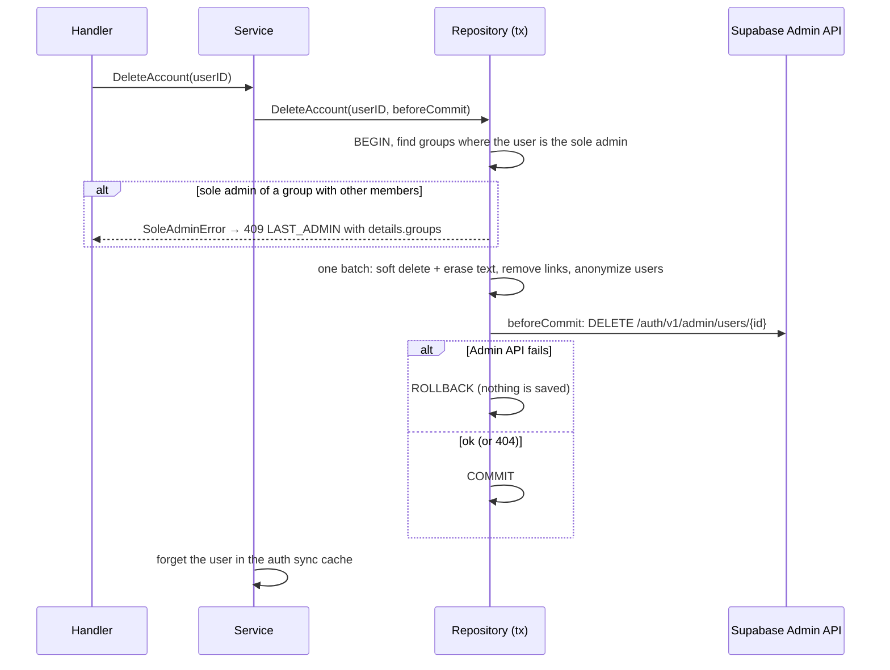

# 7. Security and privacy

Prayer requests are sensitive: health, grief, family problems. The design
assumes that leaking who wrote what, or who can see what, is the worst failure.
This document lists the defenses layer by layer, then the LGPD (Brazilian data
protection law) features, then the known gaps.

## Threat model in practice

| Threat | Main defense |
|---|---|
| Someone reads tables directly with the public anon key | RLS on every table, grants revoked (migration 000021) |
| A forged or wrong-kind JWT | Strict validation in `auth/jwks.go` |
| A user sees content they should not | One canonical visibility predicate per content type, 404 for invisible |
| Malicious image URLs (tracking pixels, `javascript:`) | `validImageURL` |
| Script loops / spam | Per-IP and per-user rate limits, Supabase auth rate limits, Turnstile |
| Stolen session after a password reset | `signOut({ scope: 'others' })` after reset; "sign out everywhere" in settings |
| Account deleted but token still valid | `ACCOUNT_DELETED` guard in the user upsert |
| Log injection through request ids | `X-Request-Id` accepted only if it matches `^[A-Za-z0-9-]{1,64}$` |

## Row level security

The frontend bundle contains the Supabase **anon key**, which can reach
PostgREST (Supabase's auto-generated REST API over the database). Before
migration 000021, anyone could read `users.email` (and write to tables)
directly with it.

000021:

- runs `ENABLE ROW LEVEL SECURITY` on every table in `public`;
- revokes all table and sequence privileges from `anon` and `authenticated`,
  including the **default privileges** for future tables;
- defines **no policies**. None are needed: the backend connects as `postgres`,
  which owns the tables and has `BYPASSRLS`, so RLS changes nothing for it.
  The only effect is that PostgREST loses access.

Rule for every new table: `ALTER TABLE ... ENABLE ROW LEVEL SECURITY` in the
migration that creates it. Default privileges are revoked, but RLS is per
table.

Supabase Storage is different: uploads go straight from the browser, so the
`avatars` and `group-photos` buckets **do** have policies (created by hand,
`DEPLOY.md §1`). Avatars: a user writes only under their own `{user_id}/`
folder. Group photos: only admins/moderators of the group in the first path
segment, checked by `is_group_admin_or_moderator`, which must be
`SECURITY DEFINER` because the policy runs as `authenticated` and that role can
no longer read `group_memberships`.

## Authentication

Details in [02-architecture.md](02-architecture.md#authentication). Summary of
the security-relevant checks:

- Algorithms limited to `ES256`/`RS256` (no `none`, no HMAC confusion).
- `aud` and `role` must be `authenticated`: `anon` and `service_role` tokens,
  signed with the same key, are rejected.
- `exp` required, 30 s leeway, `iss` must equal `JWT_ISSUER`.
- Unknown `kid` refreshes the JWKS at most every 30 s, so random `kid`s cannot
  turn into one JWKS fetch per request.
- Token without `kid` only when the JWKS has a single key.

Supabase side (dashboard, `DEPLOY.md §1.2–1.3` and `SETUP-SEGURANCA.md`):
email confirmation required, secure email change (confirm on both addresses),
minimum password length 8 (same as `PASSWORD_MIN`), Turnstile captcha on
signup, login, magic link, reset and resend. Turn the captcha on in Supabase
only **after** a frontend with `VITE_TURNSTILE_SITE_KEY` is live, or every
login fails.

## HTTP hardening

Backend (`middleware/`):

| Middleware | Effect |
|---|---|
| `SecurityHeaders` | `X-Content-Type-Options: nosniff`, `X-Frame-Options: DENY`, `Referrer-Policy: no-referrer`, `Content-Security-Policy: default-src 'none'; frame-ancestors 'none'` (not on `/docs`, which needs its own scripts) |
| `BodyLimit` | 64 KB on `/api/v1`; overflow fails JSON decoding → `INVALID_JSON` |
| `httprate.LimitByIP` | 120 requests/min per IP (after `RealIP`, so it sees the client and not the Vercel proxy) |
| `WriteRateLimit` | 30 writes (POST/PATCH/PUT/DELETE) per minute per user → `429 RATE_LIMITED` |
| `UUIDParams` | Malformed ids → `400 INVALID_ID` before they reach SQL |
| `RequestID` | Client ids only in a safe format |

Rate limits live in each instance's memory. On Vercel, instances count
independently, so these are best-effort brakes against a looping script, not
exact quotas. The real brake on auth and email is Supabase's own rate limiting.

Frontend (`frontend/vercel.json`): HSTS (2 years, subdomains), `nosniff`,
`X-Frame-Options: DENY`, `strict-origin-when-cross-origin`, a
`Permissions-Policy` that turns off camera, microphone, geolocation and
payment, and a CSP that only allows the app itself, Google Fonts, the Supabase
project (HTTPS and WSS) and Cloudflare Turnstile. A new third-party origin
(analytics, CDN, API) must be added to the CSP or the browser blocks it.

## Authorization and data exposure

- **Canonical predicates** (`prayerRequestVisibleTo`, `verseShareVisibleTo`)
  decide visibility everywhere: detail, reactions, "who prayed", updates.
- **Invisible = 404**, never 403, so ids cannot be probed for existence.
- **Blocks apply in both directions** on every read path.
- **Anonymous requests** hide the author's name and avatar for everyone but the
  author, in the request and in its updates, and are never used as a friend's
  "latest intention" (see the gap below).
- **Moderation reasons** are visible only to the author and the group's
  moderators/admins.
- **Image URLs** (`validImageURL` in `service.go`): avatar, group cover and
  announcement image accept only empty (clear) or
  `https://<project>.supabase.co/storage/v1/object/public/...`, with no
  spaces, quotes, angle brackets or `..`. The prefix is derived from
  `JWT_ISSUER`. Without this, a client could store any URL, including a tracking
  pixel that every feed reader would load.
- **Secrets**: `SUPABASE_SERVICE_ROLE_KEY` lives only in the backend, used only
  by `supabaseadmin` for account deletion. The frontend only has the anon key
  and the Turnstile site key.

## LGPD: export and deletion

### `GET /me/export`

One statement (`exportUserDataSQL` in `repositories/account.go`) builds a single
JSON document with `json_build_object`: profile, prayer requests (with
updates), announcements, verse shares, reactions given, friendships (with
direction), group memberships, blocked users and notifications received. It
includes soft-deleted content, because it is still stored. The response has
`Cache-Control: no-store`.

**A new table holding personal data must be added to this statement.**

### `DELETE /me`

What the batch does:

| Data | Treatment |
|---|---|
| Groups where the user was the only member | Soft-deleted |
| Prayer requests | Soft-deleted, title and body replaced with `[removido]`, testimony cleared |
| Author updates | Deleted |
| Announcements | Soft-deleted, text replaced, image cleared |
| Verse shares | Soft-deleted, comment cleared |
| Memberships | Soft-deleted |
| Pending join requests, friendships, blocks (both sides) | Deleted |
| Notifications received or caused | Deleted |
| `users` row | Kept but anonymized: `display_name = 'Conta excluída'`, `username = excluido_<12 hex>`, `email = <id>@deleted.local` (frees the UNIQUE email for a new account), avatar and bio cleared, notification flags off, `deleted_at` set |

The `users` row stays because other people's reactions, moderation records and
notifications reference it without `ON DELETE CASCADE`. Reactions the user gave
remain as anonymous counts.

The Supabase user is deleted **before** the commit: if the Admin API fails,
the transaction rolls back and the account stays whole instead of half-deleted.
Without `SUPABASE_SERVICE_ROLE_KEY` the endpoint answers
`503 ACCOUNT_DELETION_UNAVAILABLE` and touches nothing.

After deletion, the access token is valid for up to an hour, but
`UpsertAuthUser` refuses to revive a row with `deleted_at`
(`ErrAccountDeleted` → `401 ACCOUNT_DELETED`), and the frontend signs out
locally when it sees that code.

The frontend asks for the current password and for the user to type their
`@username` before calling the endpoint (`components/account-security.tsx`).

## Known gaps

⚠️ **Anonymous requests still expose `authorId`.** The enrich clears the
author's username, display name and avatar for anonymous requests, but
`PrayerRequest.AuthorID` is serialized as `authorId` in every feed and detail
response. Anyone who sees an anonymous request and any non-anonymous content by
the same person (or their profile's content) can match the UUIDs and identify
the author. The code comment says the id "is not exposed in any user-by-id
route", but the id itself is enough to correlate. Fix: blank `AuthorID` for
non-authors in the same branch that sets "Anônimo", and check the frontend does
not rely on it (it is used to decide "is this mine?", which only needs to work
for the author).

⚠️ **Editing bypasses moderation.** `UpdatePrayerRequest` sets
`status = 'ACTIVE'` unconditionally, so an author can re-publish a request a
moderator rejected (`REMOVED`) or skip a pending review. See
[06-domains.md](06-domains.md#status-lifecycle).

Other limitations worth knowing:

- The access token lives in `localStorage` (Supabase's default too), so an XSS
  bug would expose it. The strict CSP is the main mitigation.
- Rate limits are per instance (see above).
- No audit log for account-level actions (login, password change) beyond what
  Supabase keeps.
- No automated security tests; no dependency scanning in CI (there is no CI).
