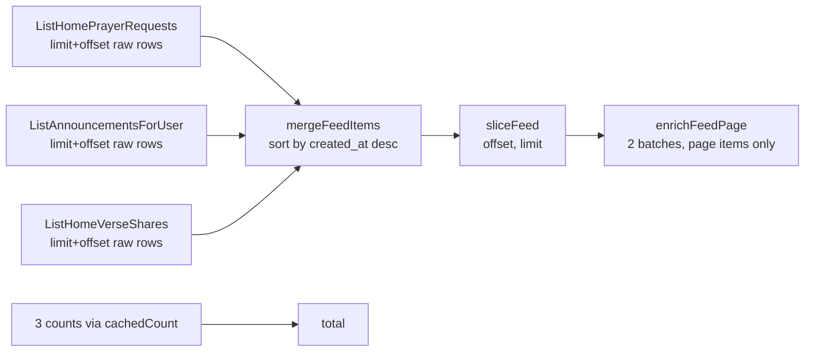

# 10. Performance

How Creo's backend and frontend were made fast, how to measure it, and the
rules that keep it that way. If you are going to touch a feed or any query,
read this document first.

The one-sentence version: **this system is limited by the number of trips to
the database, not by how long the database takes to answer.** Everything below
follows from that.

## Where the time goes

Creo runs on Vercel with the Go function in Portland (`pdx1`), next to the
Supabase database in `us-west-2` (see D05 in [08-decisions.md](08-decisions.md)).
The browser is usually in Brazil.

| Hop | Cost |
|---|---|
| Browser (Brazil) → function (`pdx1`) | ~160 ms, paid **once** per request |
| Function (`pdx1`) → database | < 5 ms per trip |
| Browser/laptop in Brazil → database directly (local dev) | ~200 ms **per trip** |
| One statement vs. fifty statements in one message | the same trip |
| Query execution at today's volume | negligible |

Today's volume is dozens of rows per table (October 2026: 24 `users`, 6
`prayer_requests`). At that size the planner ignores indexes and every query is
instant, so the only thing that scales with the code you write is **how many
times you cross the network**.

Two consequences:

1. The function region matters more than any query. Before it was pinned to
   `pdx1`, the function was silently running in `iad1`, with ~60 ms per trip.
   The region is set in the Vercel dashboard (Settings → Functions → Function
   Region), because `experimentalServices` ignores `regions` in `vercel.json`.
2. The numbers in this document were measured with ~200 ms per trip, i.e. from
   a laptop in Brazil talking straight to Supabase. That is the worst case and
   it makes regressions impossible to miss. In production the same code costs
   a fraction of that per trip, and the ratio between "before" and "after"
   stays the same.

## How to measure

**Count trips before optimizing anything.**

Every request is instrumented by `internal/db/trace.go`. `db.Tracer` implements
`pgx.QueryTracer` and `pgx.BatchTracer`, is attached to the pool in
`cmd/api/main.go` (`poolCfg.ConnConfig.Tracer`), and accumulates into a
`db.Stats` stored in the request context by the logging middleware
(`internal/http/middleware/logging.go`).

| Counter | Meaning |
|---|---|
| `dbRoundTrips` | Trips to the database. A `pgx.Batch` counts as **one**, on purpose |
| `dbStatements` | Statements sent. Larger than `dbRoundTrips` when batches are used |
| `dbDuration` | Summed time of all trips. Under parallelism it can exceed the request time |
| `coldStart` | `true` on the first request served by an instance |

Where to read them:

- **Backend log**: the `http_request` line (JSON, zap) has all four, plus
  `requestId`, `status` and `duration`.
- **Response header**: `Server-Timing: app;dur=…, db;dur=…;desc="N rt"`, and
  `cold;desc="cold start"` on the first request of an instance. It shows up in
  the DevTools Timing tab, so you can read it in production without logs.
- **Region check**: the `x-vercel-id` response header should look like
  `gru1::pdx1::…` (edge::function). Anything other than `pdx1` in the second
  slot means the region setting was lost.

Workflow for any query-path change:

1. Call the endpoint and write down `dbRoundTrips` and `duration`.
2. Make the change.
3. Call it again and compare. A change that does not reduce trips on a
   trip-bound path is not an optimization.

Do not infer trips from reading the code: a helper that "looks like one query"
may run two, and a batch that "looks like five" is one.

## The toolbox

Three tools, each with its place. Pick the first one that fits.

### 1. `pgx.Batch` when the queries live in the same repository method

Collapses N trips into 1 on a single connection. First choice. The results are
consumed in the order they were queued with `nextBatchRows(br, scan)`
(`repositories/repository.go`).

Already applied in:

| Method | What is batched |
|---|---|
| `EnrichPrayerRequests` | authors, answered state, groups, per-type counts, the viewer's own reactions |
| `EnrichVerseShares` | the same for verse shares |
| `GetUserStats` | the profile counters |
| `ListModerationHistory` | access check and the history |
| `ListPrayerActionsByRequest` | access check and the "who prayed" list |
| `ListPrayerRequestUpdates` | access check and the updates |
| `ListVerseShareActions` | access check and the list; the list is discarded if access is denied |
| `emitReactionSideEffects` | author notification and both milestones |
| `DeleteAccount` (`account.go`) | the deletion steps, inside the transaction |

A batch uses **one** connection, so it also costs one slot of the pool.

### 2. Writable CTE when a write depends on reads

When the outcome of a write depends on what is in the database, resolve it all
in one statement and return flags so Go can pick the error without another
query.

`reactionSQL` is the reference. In order, it:

1. `viewer`: reads the user's tradition, resolves the default reaction type and
   the allowed list;
2. `target`: applies the canonical visibility predicate to the request or verse
   share;
3. `inserted`: inserts only if the type is allowed, the target is visible and
   there is no identical reaction inside the dedupe window
   (`PRAYED_WINDOW_HOURS`, default 12);
4. `afterInsert` (optional): bumps `prayer_requests.prayed_count`;
5. returns four booleans/values: Go maps them to `ErrPrayerActionNotAllowed`,
   not found or `ErrDuplicatePrayedAction`.

The same idea resolves notifications in SQL. Finding the author, checking the
dedupe window and inserting used to be three trips; now it is one
`INSERT ... SELECT` where `author_id <> actor` prevents self-notification and a
`NOT EXISTS` enforces the 60-minute window (`reactionNotifySQL`). Milestones are
resolved the same way (`prayedMilestoneSQL`, `streakMilestoneSQL`).

### 3. `errgroup` when the calls cross repository methods

Merged feeds call several repository methods (requests, announcements, verse
shares, and their counts). They run in parallel through `runBounded`
(`services/service.go`), **never** through a raw `errgroup`.

`maxParallelQueries = 3` exists because `DB_MAX_CONNS` is 8 for the whole
process (kept low for the Supabase pooler). An unbounded fan-out of six inside
one request would take most of the pool and make latency worse under load. The
errgroup context cancels sibling tasks on the first error.

Priority: batch inside a method (tool 1), fold dependent work into one
statement (tool 2), and only then parallelize across methods (tool 3).
Parallelism hides latency but still spends pool connections; batching and CTEs
remove the trip.

## Merged feeds

Home, groups, friends, public and the group wall mix up to three item types
(prayer requests, announcements, verse shares) into one list ordered by
`created_at`.

What changed and why:

| Before (July 2026) | After |
|---|---|
| Each stream enriched its own `limit + offset` rows (authors, groups, reaction counts) and the service threw the excess away | Streams return **raw** rows. The service merges and slices, then `enrichFeedPage` enriches only the final page, in two batches |
| One `COUNT(*)` per stream, re-running the whole CTE on every page load, even for anonymous visitors | Counts go through `Service.cachedCount` (in-process, 30 s TTL, `feedCountTTL`). The total only feeds the numbered pager, so 30 s of staleness is fine |
| Sequential calls | Streams and counts run in parallel through `runBounded` (max 3) |
| Reaction counts scanned `prayer_actions` | Index `(prayer_request_id, action_type)` (migration 000016) |

Rules that follow:

- Each stream fetches `limit + offset` **raw** rows. Do not enrich inside the
  `List*` methods (`ListHomePrayerRequests`, `ListGroupsPrayerRequests`,
  `ListPrayerRequestsByGroup`, `List*VerseShares`, `ListPublicPrayerRequests`,
  `ListFriendsPrayerRequests`). The last two used to enrich internally and that
  doubled the cost of the feed.
- `mergeFeedItems(streams ...[]models.FeedItem)` is variadic. A new item type is
  one more stream, not one more positional parameter.
- New feed counts must use `cachedCount`.
- Preserve the tradition filter and `deleted_at IS NULL` in every stream
  (see [06-domains.md](06-domains.md)).
- The group wall checks access first (`ensureGroupFeedAccess`), sequentially on
  purpose: nothing is read before access is granted.
- Anonymous public feed responds with
  `Cache-Control: public, s-maxage=30, stale-while-revalidate=60`
  (`prayer_handler.go`) so the Vercel CDN absorbs it. Never add cache headers to
  an authenticated response without thinking about `Vary`: the verse endpoint
  deliberately has none because it is personalized.

## Side effects without background work

The tempting design is to respond immediately and send notifications and
milestones from a goroutine. It does not work here: the Vercel function freezes
once it responds, and the work would die halfway (D07).

So the tail is **batched**, not deferred. A reaction is two fixed trips:

1. the statement that decides and writes (`recordPrayerActionSQL` /
   `recordVerseShareActionSQL`);
2. one best-effort batch (`emitReactionSideEffects`) with the author
   notification plus the `MILESTONE_PRAYED` and `MILESTONE_STREAK` checks.

They cannot be merged into one: the side effect needs the reaction committed,
and a failure in it must not undo the reaction. Notifications stay best-effort
(`_ = insertNotificationOn(...)`).

## Caches

All in-process and per instance. On Vercel each instance has its own copy and
starts cold, so they reduce trips on warm instances and never affect
correctness. The two service maps clean expired entries opportunistically once
they pass 4096 keys.

| Cache | Where | TTL | What it saves |
|---|---|---|---|
| `feedCounts` (`cachedCount`) | `service.go` | 30 s | Feed totals and verse pool size: one `COUNT(*)` per stream per page |
| `syncedAuth` (`ttlSeen`) | `service.go` | 60 s | The `users` upsert in `ensureAuthUser`: one trip on every authenticated request. Keyed by the token's data, not only the id, so a change in Supabase syncs immediately |
| JWKS keys | `auth/jwks.go` | 10 min | Fetching keys per request. An unknown `kid` forces a refresh at most once every 30 s |
| `singleflight` | `bible/bible.go` | per call | Concurrent fetches of the same verse text |
| CDN | `Cache-Control` on the anonymous public feed | 30 s | The whole request |
| Verse text | `bible_verses.text` column | permanent | The third-party Bible API leaves the hot path after the first read |

## Results

Measured in September 2026 with ~200 ms per round trip:

| Path | Before | After | Change |
|---|---|---|---|
| `ListFriendsFeed` | 4189 ms | 430 ms | ~9.7× |
| `ListGroupsFeed` | 2920 ms | 415 ms | ~7.0× |
| `ListHomeFeed` | 2502 ms | 421 ms | ~5.9× |
| `ListPublicFeed` | 2256 ms | 411 ms | ~5.5× |
| `ListGroupFeed` | 1839 ms | 617 ms | ~3.0× |
| `GetUserStats` | 1164 ms | 207 ms | ~5.6× |
| `RecordPrayerAction` | 5–7 trips | 2 trips | |
| `RecordVerseShareAction` | 7–9 trips | 2 trips | |

Reading the table: the feeds now sit at about two trips' worth of time
(~400 ms at 200 ms per trip). `GetUserStats` is a single trip. `ListGroupFeed`
is slower than the others because the access check is sequential by design.

## Database

- **Index added where the access pattern was certain**: `prayer_actions
  (prayer_request_id, action_type)` (migration 000016), serving the reaction
  aggregation in the feed enrich. Without it the hottest query of the feed
  scanned the fastest-growing table.
- **Duplicate index dropped**: `idx_notifications_user_created` duplicated
  `idx_notifications_user_created_at` (migration 000017). It cost a write on
  every notification for no read benefit.
- **Announcement fan-out in one statement**: `notifyGroupMembersOfAnnouncement`
  is a single `INSERT ... SELECT` over `group_memberships` instead of one
  insert per member. In a 500-member group that is 1 trip instead of 500.
- **Counters in one statement**: `GET /notifications/unread-count` is a single
  statement (`notificationSummarySQL`) because the shell polls it every 30 s.
- **Pool**: `DB_MAX_CONNS` 8, `DB_MIN_CONNS` 0, connection lifetime 30 min,
  idle 5 min. Kept small on purpose for the Supabase pooler on `:6543`.
- **No more indexes yet** (D09): with dozens of rows the planner ignores them,
  so tuning now would be guesswork. Index work starts after a representative
  dataset is seeded. Until then, optimize trips.

## Frontend

The same discipline, applied to HTTP requests instead of database trips.

- **One profile query**: every screen uses `['profile', 'me']` for `GET
  /profile`. Before, `['profile','feed']`, `['profile','shell']` and others
  fetched the same URL several times without deduplication. Do not create
  variations.
- **One notification counter query**: everything reads `useNotificationSummary()`
  (`lib/use-notifications.ts`, key `['notifications','unread-count']`). Do not
  add another counter query.
- **Polling only when it matters**: `refetchInterval: 30_000` with
  `refetchIntervalInBackground: false`, so a background tab does not poll.
- **Prefetch on intent**: feed tabs prefetch on hover and focus
  (`prefetchScope` in `feed-page.tsx`) instead of eagerly prefetching every tab
  on load, which competed with the visible feed. The next page of the current
  tab is still prefetched, but only after the visible feed has resolved.
- **Surgical invalidation**: a reaction invalidates only what changed instead of
  the whole `['feed']` tree, and uses an optimistic update with rollback.
- **A single composer**: one global `NewRequestModal` driven by
  `state/composer-store.ts`. A second local modal in the feed was removed.
- **Bundle splitting**: `manualChunks` in `vite.config.ts` moves heavy vendors
  (supabase-js, i18next, TanStack Query, `motion`) into their own chunks. All
  routes are lazy. The landing page lives in the initial bundle, so it must not
  import heavy pieces such as `feed-card`.
- **Static asset caching** (`frontend/vercel.json`): `/assets/*` is
  `immutable` for a year; images get a day plus `stale-while-revalidate`.
- **Dead weight removed**: an unused 178 KB `favicon.png` was deleted and
  `creo-icon.png` went from 178 KB to 22 KB.
- **Motion budget**: animations stay between 120 and 400 ms and respect reduced
  motion (see [05-frontend.md](05-frontend.md)).

## What was deliberately not done

| Not done | Why | Revisit if |
|---|---|---|
| Keyset pagination (D11) | The product wants a numbered pager. Fetching `limit + offset` per stream degrades with deep pages, but nobody scrolls that deep yet | People actually reach deep pages, or the feed becomes infinite scroll |
| Background jobs (D07) | The Vercel function freezes after the response | A queue or long-running worker enters the stack |
| More indexes (D09) | The planner ignores them at this volume | Any table reaches thousands of rows, or `dbDuration` grows |
| Self-hosting / subsetting Google Fonts | Touches visual identity and the gain is unmeasured | A measurement shows fonts dominating first paint |
| Realtime instead of polling (D06) | Seconds of delay do not matter for a prayer app; realtime would also need RLS policies (D14) | Live features such as "praying now" rooms become a goal |
| Optimistic updates in request detail and notifications | Lower value than the feed paths | Users perceive latency there |

## Known limits

- Deep pages get slower: each stream fetches `limit + offset` rows. Totals are
  approximate (cached 30 s).
- The write rate limit (30 writes/min per user) and the in-process caches live
  in each instance's memory. On Vercel they are best-effort, not global.
- The catalog hydration of verse text calls a third-party API with a 3 s
  timeout on the first read of each verse. It never fails the request, but that
  one read is slow.
- The first request on a cold instance pays startup plus a fresh pool. It is
  flagged with `cold` in `Server-Timing` so it does not get mistaken for a
  regression.
- A function running outside `pdx1` pays far more per trip (it ran in `iad1`
  at ~60 ms per trip, against < 5 ms from `pdx1`). Check `x-vercel-id` after
  deploys.

## Checklist for a new query path

1. Repository method: can the reads be one `pgx.Batch`? Can a dependent write
   be a CTE with flags?
2. Reuse the canonical visibility predicates; do not reimplement them.
3. Feed stream: raw rows only, no enrich; preserve tradition and
   `deleted_at IS NULL`; counts through `cachedCount`.
4. Cross-method fan-out: `runBounded`, never a raw `errgroup`.
5. Side effects: batch them into the request; do not leave work for after the
   response.
6. Call the endpoint and check `dbRoundTrips` in the log or `Server-Timing`
   before calling it done.
7. Frontend: reuse an existing query key; invalidate the narrowest key that
   changed; poll only when the tab is visible.
